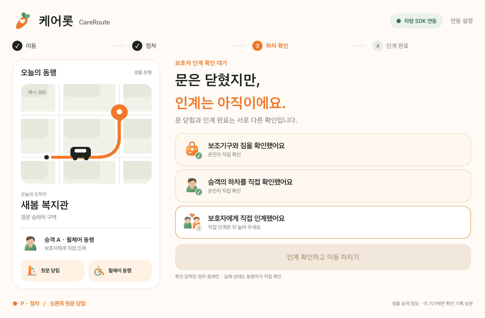

# 케어롯 CareRoute

차량의 문이 닫혀도, 보호자 인계가 끝났다는 뜻은 아닙니다. 케어롯 CareRoute는 차량의 기어·문 상태와 운전자 직접 확인을 연결해 교통약자의 하차부터 보호자 인계까지 하나의 흐름으로 기록하는 Pleos Connect 앱입니다.

[케어롯 소개·시연 영상 (36초)](docs/media/CareRoute_케어롯_시연영상.mp4)

영상은 직접 제작한 3D 상황 연출과 현재 APK의 실제 화면을 확대·편집한 모션그래픽입니다. 모든 장면이 에뮬레이터 화면 녹화라는 뜻은 아닙니다. 실제 SDK 연동 검증 절차는 아래 안내와 docs/VALIDATION.md를 따릅니다.



## 제출 버전

- 제출 앱 버전: **1.2.1 (versionCode 4)**. 큰 글자·주황색 강조·직접 그린 로고와 확인 아이콘을 적용했습니다.
- Android 네이티브 Java 앱, release APK는 `apk/CareRoute_케어롯_release.apk`에 있습니다.
- Pleos Vehicle SDK **2.3.2**의 실제 조회·리스너 API를 사용합니다.
- 읽기 권한 `CAR_DOORS`, `CAR_DRIVE`만 선언합니다. 차량 제어 API는 호출하지 않습니다.
- 가상 승객 1명과 가상 목적지 1곳을 사용한 핵심 흐름 MVP입니다.
- `차량 SDK 연동` 모드와 `시연 데이터` 모드를 구분합니다.
- 확인 기록은 이 기기에 저장합니다. 앱 자체에 외부 서버 전송 기능은 없습니다.

## 60초 체험

앱을 처음 실행하면 명확히 표시된 시연 데이터 모드로 시작합니다.

1. 아래 **P 정차**를 누릅니다. 문이 열리기 전에는 확인 입력이 비활성화됩니다.
2. **문 열기**를 누릅니다. 보조기구·짐과 승객 하차를 직접 확인합니다.
3. **문 닫기**를 누릅니다. 보호자 인계가 미확인인 동안 이동 완료 버튼은 활성화되지 않습니다.
4. **보호자에게 직접 인계했어요**를 확인하고 **인계 확인하고 이동 마치기**를 누릅니다.
5. **주행**에서는 확인 입력이 표시되지 않습니다.

## Pleos SDK 연동으로 검증하기

공식 Pleos Connect Emulator **v2.1.0, API34** 환경에서 앱을 설치합니다.

```sh
adb install -r apk/CareRoute_케어롯_release.apk
adb shell am start -n io.careroute.app/.MainActivity --es mode live --ez reset true
adb forward tcp:8088 tcp:8088
```

PC 브라우저에서 `http://127.0.0.1:8088/`를 열어 공식 Virtual Console을 사용합니다.

1. 기어 **P**를 선택합니다.
2. Body의 **RR door**를 열고 앱이 하차 확인 상태가 되는지 확인합니다.
3. RR door를 닫으면 앱이 인계 대기를 유지합니다.
4. 운전자의 직접 확인을 마쳐야 앱의 기록을 완료할 수 있습니다.
5. **D** 기어에서는 입력이 제한됩니다.

에뮬레이터 신호를 읽어 검증한 것이며 실차 테스트를 수행했다는 의미는 아닙니다. 차종별 API 지원 여부와 권한을 확인해야 합니다. 오른쪽 뒷문 영역을 지원하지 않으면 연결 안내를 표시하고 확인 입력을 허용하지 않습니다. SDK 연결이 실패해도 자동으로 시연 데이터로 전환하지 않습니다.

## 개발 환경과 빌드

- JDK 17 이상, 검증 환경 JDK21
- Gradle 8.13 / Android Gradle Plugin 8.13.2
- Android SDK Platform34 / Build Tools36.0.0
- minSdk28 / targetSdk34

프로젝트 루트에 개발 PC의 SDK 경로를 `local.properties`로 설정한 뒤 실행합니다.

```properties
sdk.dir=/absolute/path/to/Android/Sdk
```

```sh
./gradlew testDebugUnitTest assembleDebug
./gradlew lintRelease
```

Windows에서는 `gradlew.bat`를 사용합니다. release 재서명에는 본인의 키를 사용하세요. 서명 키와 비밀번호는 저장소에 포함하지 않습니다. `signing.properties`를 제공하지 않으면 release는 unsigned로 빌드됩니다.

```properties
# signing.properties — Git에 올리지 마세요
storeFile=/absolute/path/to/your-keystore.jks
storePassword=your-password
keyAlias=your-alias
keyPassword=your-password
```

## 구현 구조

| 파일 | 역할 |
|---|---|
| `CareSession.java` | 상태·확인 순서·데이터 신선도·완료 조건 |
| `PleosGateway.java` | SDK 지원 확인, 문·기어 조회와 구독, 리소스 해제 |
| `MainActivity.java` | 차량 화면 크기에 반응하는 네이티브 UI와 시연 모드 |
| `CareSessionTest.java` | 문 닫힘 오인, 주행·미수신·오래된 데이터 등 단위 검증 |

검증 범위와 미구현 범위는 [검증 기록](docs/VALIDATION.md), 서비스 가설과 확장 계획은 [서비스 설계](docs/PRODUCT.md)를 확인하세요.

## 공식 문서

- [SDK 개발 환경](https://document.pleos.ai/docs/connect/guide/getting-started/application-development/setup-connect-sdk-emulator)
- [Vehicle SDK](https://document.pleos.ai/docs/pleos-only/connect-sdk-pleos/Vehicle/intro)
- [Virtual Console](https://document.pleos.ai/docs/connect/guide/getting-started/application-development/use-vehicle-emulator)
- [API 호환성](https://document.pleos.ai/docs/pleos-only/vehicle-app-planning-guide/api-compatibility-availability)
- [주행 규제](https://document.pleos.ai/docs/pleos-only/vehicle-app-developer-guide/driving-restriction-development-guide)

## 권리와 구성 요소

프로젝트 소스·화면 구성·직접 그린 벡터 그래픽의 권리는 출품자에게 있습니다. 별도 공개 사용 허락은 부여하지 않습니다. 제3자 SDK·라이브러리는 각 공급자의 조건을 따릅니다. [구성 요소 안내](THIRD_PARTY_NOTICES.md)를 참고하세요. 개인정보와 서명은 저장소에 포함하지 않습니다.
